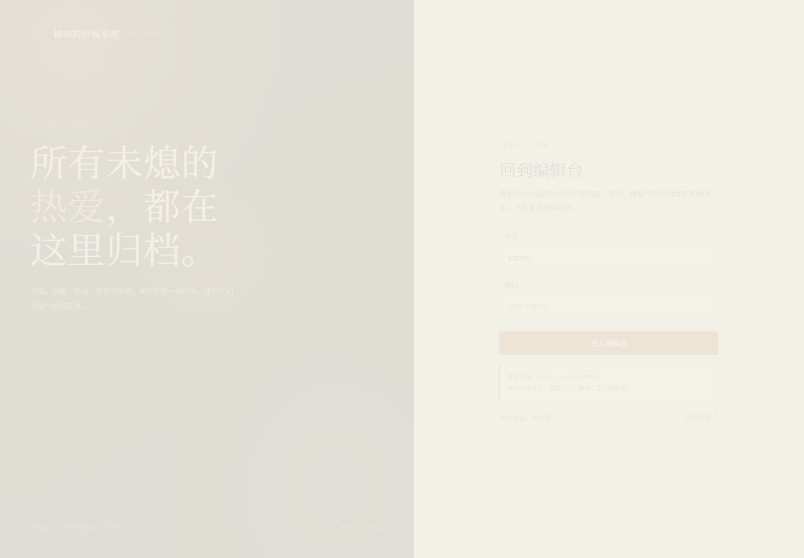
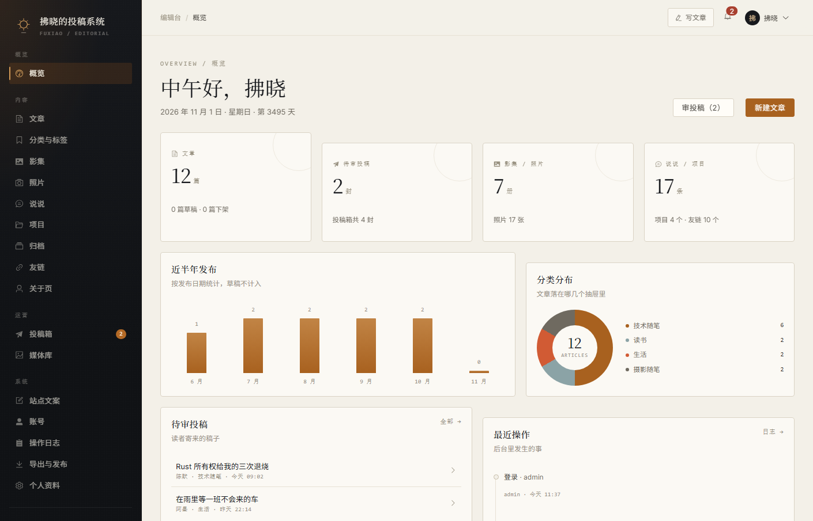
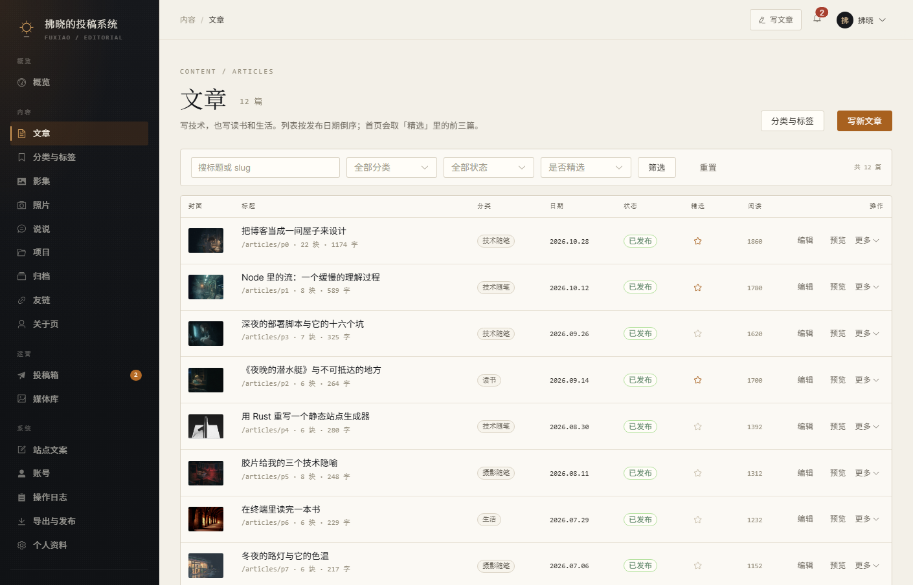
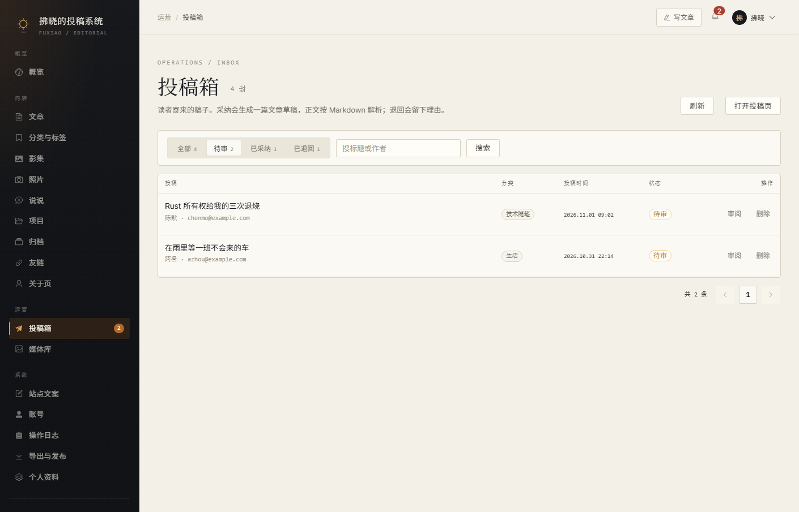
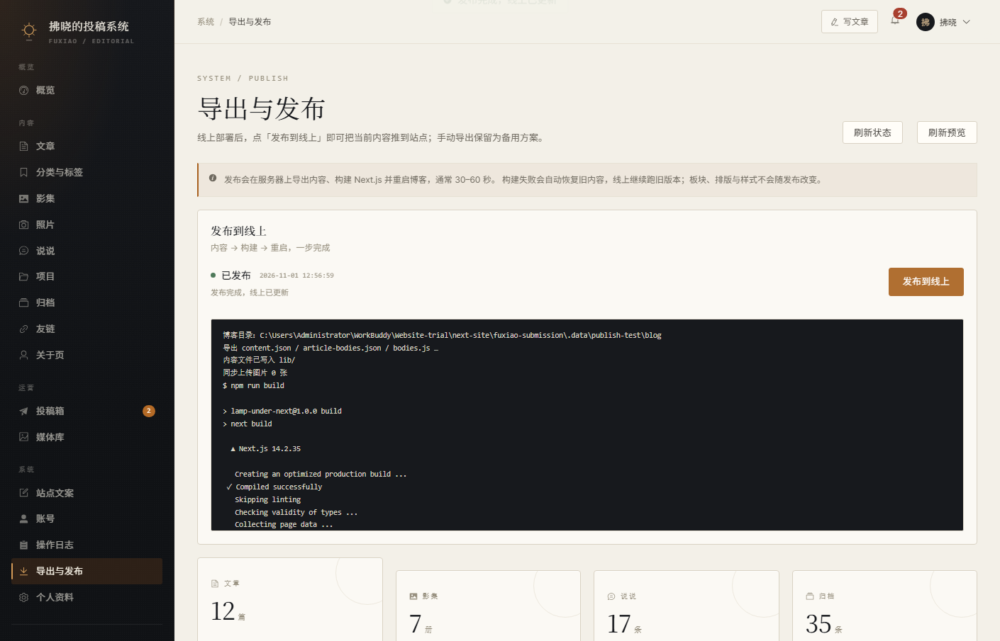

# 拂晓的投稿系统

一个独立于博客前端的后台管理平台：用它来写文章、排影集、整理说说与项目、处理读者投稿、
维护站点文案，最后把内容导出回博客。

- 后台管理：**Vue 3 + TypeScript + Vite + Element Plus**
- 后端：**Java 17 + Spring Boot 3 + Spring Security + Spring Data JPA**
- 数据库：**MySQL 8**
- 形态：`admin-web` 与 `backend` 两个独立应用，和博客（Next.js）互不侵入

> 界面上的一切都围绕「内容」：**板块、排版与样式不在本系统的修改范围内**。
> 导航结构、页面栅格、颜色与字体仍然由博客前端代码决定。

---

## 1. 它是做什么的

博客现在的全部内容都写死在 `lib/content.json`、`lib/bodies.js` 和 `lib/article-p0.json` 里，
改一篇文章要动代码。这个系统把内容搬进 MySQL，用一套面向写作者的界面来管理：

| 模块 | 能做什么 |
| --- | --- |
| 概览 | 文章/影集/说说/投稿统计、近半年发布趋势、分类分布、内容体检、最近操作 |
| 文章 | 增删改查、草稿/发布/下架、首页精选、封面、摘要与导语、标签、分块正文（段落/小标题/引用/代码/插图）、Markdown 导入、预览 |
| 分类与标签 | 分类排序与显隐、文章数统计、标签重命名（批量写回文章） |
| 影集 | 封面、引子、封面信息、规格表、两段文字与两处引言、两组图组、排序与发布 |
| 照片 | 全部作品 / 散图两个分区、EXIF、拍摄日期、排序与显隐 |
| 说说 | 时间、标签、多段正文、配图、发布开关 |
| 项目 | 状态、进度、说明、技术清单、截图、标签；另有「还没开始的」待办清单 |
| 归档 | 按年份查看、手动补录、一键从已发布文章同步 |
| 友链 | 站名、显示地址、跳转链接、介绍、排序与显隐 |
| 关于页 | 名字、身份、人像、简介段落、三栏清单、图片来源、联系方式 |
| 投稿箱 | 读者投稿列表、详情、采纳为草稿 / 采纳并发布、退回并留下理由、删除 |
| 媒体库 | 浏览博客原有图片、上传新图、复制路径、删除上传图 |
| 站点文案 | 首页、各页引言、页脚、关于页等约 60 条文案的逐条编辑；首页「此刻」四格 |
| 账号 | 管理员/编辑两种角色、启停、重置密码（仅管理员） |
| 操作日志 | 谁在什么时候动了什么（仅管理员） |
| 导出与发布 | 线上部署后一键发布（导出 → 构建 → 重启）；也可手动下载 `content.json`、完整 ZIP 备用 |
| 个人资料 | 昵称、邮箱、头像、修改密码 |
| 公开投稿页 | `/submit`，无需登录，读者可直接寄稿 |

首次启动会从博客现有内容生成一份演示数据：12 篇文章、7 册影集、17 条说说、4 个项目、
17 张照片、10 个友链、35 条归档、4 封投稿样例。

---

## 2. 目录

```text
fuxiao-submission/
├─ README.md
├─ setup-local.cmd / start-local.cmd / stop-local.cmd   # 双击即可
├─ scripts/                    # 便携启动、停止、状态、重置数据库
├─ docker-compose.yml          # 可选：MySQL 8（Docker Desktop）
├─ db/
│  ├─ schema.sql               # 建库建表
│  └─ data.sql                 # 演示数据（由 tools/seed.mjs 生成）
├─ tools/
│  ├─ seed.mjs                 # 从博客内容生成 data.sql
│  ├─ fetch.mjs                # Node 下载器（绕开 curl 证书问题）
│  ├─ check-seed.mjs           # 校验 data.sql 的字段数、引号与 JSON
│  ├─ check-schema.mjs         # 校验 schema / 实体 / 数据列三方一致
│  ├─ check-java.mjs           # 无 JDK 环境下的后端静态自检
│  ├─ check-calls.mjs          # 校验 Service / Repository 调用与参数个数
│  ├─ check-entities.mjs       # 校验实体 getter/setter 调用
│  ├─ check-web.mjs            # 前端模板/脚本/import 静态自检
│  └─ ParseJava.java           # 借 JDK 的 javac 做纯语法解析
├─ backend/                    # Spring Boot 服务
│  ├─ pom.xml
│  ├─ run.ps1
│  └─ src/main/java/com/fuxiao/submission/...
├─ admin-web/                  # Vue 3 管理台
│  ├─ package.json
│  ├─ package-lock.json
│  ├─ vite.config.ts
│  └─ src/...
├─ docs/API.md                 # 接口一览
├─ docs/DEPLOY_TENCENT.md      # 腾讯云 Ubuntu 24.04 部署
├─ docs/screenshots/           # 真实运行截图
├─ deploy/tencent/             # bootstrap / deploy / backup / Nginx / systemd
└─ deploy/nginx.conf.example   # 通用反代示例
```

---

## 3. 快速开始

> **不用 Docker。** 这台机器没有安装 Docker Desktop（它需要管理员权限、WSL2 和重启），
> 所以项目自带一套 Windows 便携模式：MySQL 8、Maven、前端依赖都装在
> `fuxiao-submission/.tools` 和 `.data` 里，不需要管理员权限，也不影响系统里已有的软件。

### 3.1 Windows 便携模式（推荐）

只需要 **Node 18+**。JDK 会自动查找（本机可用 Minecraft 自带的 JDK 21，或系统 `JAVA_HOME`）；
找不到时 setup 会下载 Temurin 21。

在 `fuxiao-submission` 目录执行：

```powershell
.\setup-local.cmd
.\start-local.cmd
```

等价的 PowerShell 命令：

```powershell
powershell -NoProfile -ExecutionPolicy Bypass -File .\scripts\local-setup.ps1
powershell -NoProfile -ExecutionPolicy Bypass -File .\scripts\local-start.ps1
```

- 第一次 `setup`：下载 Maven 3.9.9（约 9MB）和 MySQL 8.0.28（约 212MB），初始化数据库、
  导入演示数据、安装前端依赖。全部下载到项目目录，几分钟完成。
- 之后 `start`：MySQL 3307 → 后端 8080 → 管理台 5174 → 博客 3100（如果博客依赖存在）。
- 打开 <http://127.0.0.1:5174>，初始账号 **admin / fuxiao@2026**。
- 停止：`.\stop-local.cmd`；查看状态：`.\scripts\local-status.ps1`；
  重置演示数据：`.\scripts\local-reset-db.ps1`。
- 卸载：关闭服务后删除 `.tools` 与 `.data` 即可，项目源码不受影响。

`.cmd` 包装器已经带 `-ExecutionPolicy Bypass`，双击即可，不会改系统执行策略。

首次启动后建议先到「个人资料」改密码。

### 3.2 手动准备 MySQL（可选）

如果你想用自己安装的 MySQL，而不是便携版：

```bash
mysql -uroot -p < db/schema.sql
mysql -uroot -p fuxiao_admin < db/data.sql
```

然后让后端连接它（默认 3306）：

```powershell
$env:DB_URL="jdbc:mysql://127.0.0.1:3306/fuxiao_admin?useUnicode=true&characterEncoding=utf8&serverTimezone=Asia/Shanghai&useSSL=false"
$env:DB_USERNAME="root"
$env:DB_PASSWORD="你的密码"
mvn spring-boot:run
```

### 3.3 使用 Docker（可选）

如果以后安装了 Docker Desktop，也可以继续用 compose：

```bash
docker compose up -d
```

Compose 会启动 MySQL 8，创建 `fuxiao_admin` 库，并依次执行 `db/schema.sql`、`db/data.sql`。
默认 `root` / `fuxiao123`，端口 `3306`。初始化脚本只在数据卷为空时执行；
要重来：`docker compose down -v`，或手动导入。

### 3.4 手动启动后端

需要 **JDK 17+** 与 **Maven 3.9+**。

```bash
cd backend
mvn spring-boot:run
```

或 Windows：

```powershell
.\run.ps1
```

默认连接 `jdbc:mysql://127.0.0.1:3306/fuxiao_admin`，用户 `root` / `fuxiao123`。
如果用便携版的 3307 数据库，启用 `local` profile：

```powershell
$env:SPRING_PROFILES_ACTIVE="local"
mvn spring-boot:run
```

如果数据库不同，用环境变量覆盖：

```bash
DB_URL='jdbc:mysql://127.0.0.1:3306/fuxiao_admin?useUnicode=true&characterEncoding=utf8&serverTimezone=Asia/Shanghai&useSSL=false' \
DB_USERNAME=root DB_PASSWORD=your-password \
mvn spring-boot:run
```

后端启动在 <http://127.0.0.1:8080>。第一次启动会自动创建管理员：

- 账号：`admin`
- 密码：`fuxiao@2026`（可用 `ADMIN_INIT_PASSWORD` 覆盖）

登录后请立刻到「个人资料」修改密码。

### 3.5 手动启动管理台

需要 **Node 18+**（推荐 20/22）。

```bash
cd admin-web
npm install
npm run dev
```

打开 <http://127.0.0.1:5174>。

开发服务器已配置代理：

| 路径 | 目标 |
| --- | --- |
| `/api` | `http://127.0.0.1:8080` |
| `/uploads` | `http://127.0.0.1:8080` |
| `/media` | `http://127.0.0.1:3100`（博客开发服务器） |

所以想看到封面与影集图片，博客的 `npm run dev` 也要在 3100 端口跑着；
或者把 `public/media` 交给一个静态服务器，并设置 `VITE_MEDIA_BASE`。

### 3.6 界面

以下是本机真实运行的截图（1440×1000）：









---

## 4. 日常流程

### 4.1 写一篇文章

1. 「文章 → 写新文章」。
2. 填标题、分类、日期，选封面，写摘要与导语。
3. 正文用分块编辑器：段落、小标题、引用、代码、插图；也可以点「从 Markdown 导入」整体粘贴。
4. 「保存」存为草稿；「保存并发布」直接上站。
5. 首页的「精选书写」取**精选**标记里按日期排序的前三篇。

### 4.2 让文章进入归档

发布文章后，到「归档」点一次「从文章同步」。它会：

- 为缺少条目的已发布文章补上；
- 更新已有条目的标题、日期、分类；
- 移除指向草稿/下架文章的条目（手动录入、未关联文章的条目不受影响）。

概览的「内容体检」会提示还有多少篇没有同步。

### 4.3 发布到线上

腾讯云部署完成后（见 [`docs/DEPLOY_TENCENT.md`](docs/DEPLOY_TENCENT.md)），
「系统 → 导出与发布」会出现「发布到线上」：

- 后端把最新的 `content.json`、`article-bodies.json`、`bodies.js` 写入服务器上的博客源码；
- 把新上传的图片同步到 `public/media`；
- 在服务器上执行 `npm run build`，成功后重启博客；
- 通常 30–60 秒；构建失败会恢复旧内容，线上继续跑旧版本；
- 页面会显示构建日志与状态。

部署后 `https://fuxiao.art` 会自动更新，不需要下载、解压或复制文件。



**手动导出仍然保留**（「导出与发布」页面下方），用于服务器不可用或需要备份时：

- **content.json**：文章列表、分类、影集、说说、项目、友链、归档、照片、关于页简介，
  以及 `site.copy`（站点文案）、`site.now`（首页「此刻」）、`site.about`（关于页资料）。
- **完整导出包（zip）**：额外包含
  - `article-bodies.json`：每篇文章的导语与正文块；
  - `bodies.js`：可直接覆盖博客 `lib/bodies.js` 的版本（从 `article-bodies.json` 读取正文）；
  - `media-manifest.json`：后台上传过的图片清单；
  - `README.md`：接入步骤。

手动步骤：解压 → 覆盖 `lib/content.json`、`lib/article-bodies.json`、`lib/bodies.js` →
按清单复制图片到 `public/media/` → `npm run build` → 重启博客。

> 导出与发布只改内容，不会改板块、排版与样式。

> 说明：`site.copy`、`site.now`、`site.about` 是后台维护的最新文案与资料，但博客当前的页面文案、
> 人像与联系方式仍然写在 `screens/` 里。要做成「改完即生效」，需要一次性把对应页面改成从
> `content.json` 读取这些键；在那之前，可以把它们当作对照表或批量替换的依据。

> 影集封面与图组在导出时会按站点的约定写成「无扩展名 + jpg」，所以影集图片请使用 jpg 格式；
> 文章封面、插图、照片墙与散图会保留原扩展名。

### 4.4 处理投稿

- 公开投稿页：本地 `http://127.0.0.1:5174/submit`；线上 `https://fuxiao.art/submit`（跳到管理台的公开页），无需登录。
- 后台「投稿箱」默认显示待审。
- 「采纳，生成草稿」会按 Markdown 解析正文，生成一篇文章草稿，并回填文章编号；
  「采纳并发布」直接发布；「退回」必须写一句理由（会记录在投稿上）。
- 采纳后可以在抽屉里直接跳到文章编辑器继续打磨。

投稿接口是公开的，字段与示例见 `docs/API.md`；也可以把 `/submit` 嵌到博客的某个链接里。

---

## 5. 配置

后端的全部配置都在 `backend/src/main/resources/application.yml`，可用环境变量覆盖：

| 变量 | 默认值 | 说明 |
| --- | --- | --- |
| `SERVER_PORT` | `8080` | 服务端口 |
| `DB_URL` | `jdbc:mysql://127.0.0.1:3306/fuxiao_admin?...` | JDBC 地址 |
| `DB_USERNAME` | `root` | 数据库用户 |
| `DB_PASSWORD` | `fuxiao123` | 数据库密码 |
| `JWT_SECRET` | 内置演示值 | **上线必须替换**，至少 32 字节 |
| `JWT_EXPIRE_HOURS` | `72` | 登录有效期 |
| `UPLOAD_DIR` | `./uploads` | 上传目录（相对于后端工作目录） |
| `ADMIN_INIT_PASSWORD` | `fuxiao@2026` | 首次建库时管理员的初始密码 |
| `CORS_ORIGINS` | `http://localhost:5174,...` | 允许的前端来源，逗号分隔 |
| `PUBLISH_ENABLED` | `false` | 是否启用「发布到线上」；服务器上设为 `true` |
| `BLOG_DIR` | 空 | 服务器上的博客源码目录，例如 `/srv/fuxiao/app` |
| `BLOG_BUILD_COMMAND` | `npm run build` | 发布时执行的构建命令（建议绝对路径） |
| `BLOG_RESTART_COMMAND` | 空 | 构建成功后执行的命令，例如 `sudo -n systemctl restart fuxiao-blog` |
| `BLOG_HEALTH_URL` | `http://127.0.0.1:3100/` | 重启后的健康检查地址 |
| `BLOG_BUILD_TIMEOUT` | `300` | 构建超时（秒） |

前端构建变量（`admin-web/.env.production`）：

| 变量 | 默认 | 说明 |
| --- | --- | --- |
| `VITE_API_BASE` | `/api` | 后端接口前缀 |
| `VITE_BLOG_URL` | `http://localhost:3100` | 「打开博客」「在站点查看」的地址 |
| `VITE_MEDIA_BASE` | 空 | 博客图片（`/media`）的基础地址；`/uploads` 始终走同源。为空表示都用同源 |

---

## 6. 生产部署要点

腾讯云 Ubuntu 24.04 的完整步骤、DNS、HTTPS、systemd、Nginx、备份与排错，
见 **[docs/DEPLOY_TENCENT.md](docs/DEPLOY_TENCENT.md)**。摘要：

```bash
# 服务器上，代码位于 /srv/fuxiao/app
sudo bash fuxiao-submission/deploy/tencent/bootstrap.sh
sudo certbot --nginx -d fuxiao.art -d www.fuxiao.art -d admin.fuxiao.art
sudo -u fuxiao -H bash fuxiao-submission/deploy/tencent/deploy.sh
```

之后内容更新只需要在后台点「发布到线上」。

1. **构建前端**

   ```bash
   cd admin-web
   npm install
   npm run build
   # dist/ 交给 Nginx
   ```

   > 首次 `npm install` 会生成 `package-lock.json`，之后就可以改用 `npm ci`。

2. **打包后端**

   ```bash
   cd backend
   mvn clean package -DskipTests
   java -jar target/fuxiao-submission-1.0.0.jar
   ```

3. **Nginx**：参考 `deploy/nginx.conf.example`。关键是把 `/api`、`/uploads` 反代到后端，
   把 `/media` 指到博客的静态目录，其余路径 `try_files ... /index.html`（前端是 history 路由）。

4. **务必修改**：`JWT_SECRET`、数据库密码、管理员初始密码；给 `uploads/` 配好备份；
   生产只走 HTTPS。

5. **上传目录**：容器/服务重启不会丢，但换机器要一起搬走。数据库与 `uploads/` 需要一起备份。

6. **时区**：数据库、后端、前端统一按 `Asia/Shanghai` 处理；MySQL 容器已设置 `TZ`。

---

## 7. 数据模型

内容型数据（正文块、图组、规格表、多段文字）以 JSON 文本存在 `LONGTEXT` 字段里，
由后端的 `Json` 工具与实体的类型化访问器读写；一张表就是一篇完整的聚合。

| 表 | 说明 |
| --- | --- |
| `admin_user` | 后台账号（BCrypt） |
| `category` | 分类 |
| `article` | 文章（`blocks`、`tags` 为 JSON 文本） |
| `album` | 影集（`meta/specs/why/quote/story/story_quote/process/run1/run2`） |
| `moment` | 说说（`body/images`） |
| `project` | 项目（`spec/images/tags`） |
| `upcoming_project` | 还没开始的项目 |
| `photo` | 照片（`wall` / `scatter`） |
| `friend` | 友链 |
| `archive_entry` | 归档条目（可关联文章） |
| `about_profile` | 关于页（单行，`id=1`） |
| `site_setting` | 站点文案键值 |
| `now_item` | 首页「此刻」四格 |
| `submission` | 投稿 |
| `operation_log` | 操作日志 |
| `media_asset` | 媒体库（博客原有 + 后台上传） |

完整接口表见 [`docs/API.md`](docs/API.md)。

---

## 8. 常见问题

**`docker compose up -d` 直接失败 / 没有 Docker**
不需要 Docker。运行 `setup-local.cmd` 与 `start-local.cmd`（见 3.1）。
便携模式会在项目目录内放 MySQL 8 与 Maven，不依赖 Docker Desktop，也不需要管理员权限。

**提示 PowerShell 禁止运行脚本**
用项目根目录的 `.cmd` 包装器；或者：
`powershell -NoProfile -ExecutionPolicy Bypass -File .\scripts\local-start.ps1`。
这只对当前进程生效，不改系统执行策略。

**后端启动报 `Table 'fuxiao_admin.article' doesn't exist`**
没有导入 `db/schema.sql`。便携模式重新运行 `setup-local.cmd`；
手动模式先执行 `mysql -uroot -p < db/schema.sql`，再启动后端。

**登录一直失败 / 401**
确认后端启动日志里创建了管理员；如果改过 `ADMIN_INIT_PASSWORD`，只在**首次建库**时生效。
忘记密码可以在数据库里删掉 `admin_user` 里的账号后重启（仅限本地），或用另一个管理员重置。

**图片是裂的**
便携模式会一并启动博客 3100；如果博客没起来，`/media` 就没有内容。
确认 `http://127.0.0.1:3100` 可访问；生产时确认 Nginx 的 `/media` 指向博客 `public/media`。

**上传报 413 / 超过大小**
后端 `spring.servlet.multipart.max-file-size` 默认 20MB；Nginx 还要加 `client_max_body_size 25m;`。

**导出后博客页面没变**
导出只生成文件，需要覆盖博客的 `lib/content.json`、`lib/article-bodies.json`、`lib/bodies.js`
并重新构建。仅点击导出不会自动写博客目录。

**端口冲突**
便携模式固定使用 MySQL 3307、后端 8080、管理台 5174、博客 3100。
改端口时：前端改 `vite.config.ts` 的 `server.port` 并同步后端 `CORS_ORIGINS`；
后端改 `SERVER_PORT`；数据库改 `.data\mysql\my.ini` 的 `port`（同时改 `application-local.yml`）。

**想重置演示数据**
运行 `.\scripts\local-reset-db.ps1`（会二次确认）。
注意：`data.sql` 会清空内容表（不包含 `admin_user` 与 `operation_log`）。
Docker 模式则是 `docker compose down -v && docker compose up -d`。

**npm 安装很慢 / 生命周期脚本被拦截**
setup 把 npm 缓存放在 `.data\npm-cache`；如果常规安装失败，会自动改用
`--ignore-scripts` 重试，esbuild 的 Windows 二进制来自 `@esbuild/win32-x64`，不影响构建。

---

## 9. 开发与自检

> 本机实际验证（2026-11-01）：Maven 编译 96 个源文件；Spring Boot 连 MySQL 8.0.28 启动；
> 38 项 API 冒烟全部通过；Vite 生产构建 1778 个模块；无头 Edge 走真实登录并访问概览、
> 文章、投稿箱、站点文案、公开投稿页，浏览器控制台 0 错误。另用无头 Edge 真实点击
> 「发布到线上」，验证导出、构建、`.next` 原子切换、健康检查与失败回滚。截图见 `docs/screenshots/`。

没有 MySQL / JDK 的环境里，也可以跑仓库自带的静态检查：

```bash
node tools/check-seed.mjs     # data.sql 字段数、引号、JSON 可解析
node tools/check-schema.mjs   # schema / 实体 / data.sql 列一致
node tools/check-java.mjs     # 括号、import、文件名与 public 类型一致
node tools/check-calls.mjs    # Service / Repository 调用与参数个数
node tools/check-entities.mjs # 实体 getter/setter 与字段一致
node tools/check-web.mjs      # .vue 模板闭合、脚本括号、模板 TS 语法、import/导出
```

如果本机有 JDK 21，还可以做一次纯语法解析（不需要 Maven 依赖）：

```bash
javac -d .data/parse tools/ParseJava.java
java -cp .data/parse ParseJava backend/src/main/java
```

`tools/seed.mjs` 会读取博客的 `lib/content.json`、`lib/bodies.js`、`lib/article-p0.json`
与 `public/media`，重新生成 `db/data.sql`：

```bash
node tools/seed.mjs
```

如果修改了博客内容或新增了图片，重跑一次即可。

---

## 10. 设计说明

界面的底色、墨色与琥珀色取自博客本身：纸是暖灰的，字是近黑的，灯只在该亮的地方亮。
后台没有沿用博客的营销式排版，而是把重点放在「一屏能做完一件事」：

- 左侧深色导航按「概览 / 内容 / 运营 / 系统」分组，待审投稿有数字角标；
- 所有编辑页采用「正文 + 右侧属性栏」的编辑台结构，桌面端属性栏吸顶；
- 列表与表单使用细边框、等宽数字和小字号标签，减少装饰，让内容本身醒目；
- 预览抽屉复用博客的正文排版，所见即所得。

---

许可：个人自用项目，随博客一起维护。
