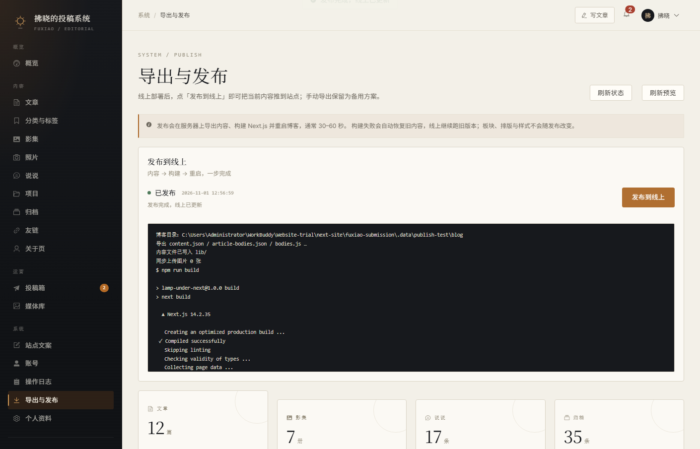

# 腾讯云 Ubuntu 24.04 部署指南

目标：`https://fuxiao.art` 是博客，`https://admin.fuxiao.art` 是管理台。
后台点「发布到线上」后，服务器自动导出内容、构建 Next.js、重启博客，30–60 秒生效；不需要下载或复制文件。

---

## 0. 架构

```text
                    腾讯云 Ubuntu 24.04（4C4G）
                              │
                       Nginx :80 / :443
          ┌───────────────────┼────────────────────┐
          │                   │                    │
   fuxiao.art/           /api/、/uploads/     admin.fuxiao.art/
          │                   │                    │
   Next.js :3100        Spring Boot :8080     Vue dist（静态）
          │                   │
          └────────── MySQL 8（127.0.0.1:3306）──────────┘
```

| 路径 | 去向 |
| --- | --- |
| `/srv/fuxiao/app` | 博客源码 + 发布后的 `lib/content.json` 等 |
| `/srv/fuxiao/api` | 后端 `app.jar` 与 `.env` |
| `/srv/fuxiao/admin` | 管理台 `dist` |
| `/srv/fuxiao/uploads` | 后台上传图片 |
| `/srv/fuxiao/backups` | 数据库与图片备份 |

系统服务：

- `fuxiao-api.service`：Spring Boot
- `fuxiao-blog.service`：`next start -p 3100`
- `mysql.service`、`nginx.service`

---

## 1. 域名与安全组

### 1.1 DNS

在域名服务商（腾讯云 DNSPod 或原服务商）添加：

```text
@       A   <服务器公网 IP>
www     A   <服务器公网 IP>
admin   A   <服务器公网 IP>
```

TTL 先 600 秒。验证：

```bash
dig +short fuxiao.art
dig +short admin.fuxiao.art
```

返回公网 IP 后再做下一步。**证书申请依赖 DNS 生效。**

### 1.2 腾讯云安全组 / 防火墙

只放行：

- `22/tcp`：最好限制为你的固定 IP
- `80/tcp`：证书申请与 HTTP
- `443/tcp`：HTTPS

**不要放行 3306、8080、3100。** 这些只监听本机。

Ubuntu 内部的 UFW 由 `bootstrap.sh` 配置。

### 1.3 备案

备案已完成。如果备案不是在腾讯云接入的，先在腾讯云备案控制台完成**接入备案**，否则解析到腾讯云 IP 后可能被拦截。

---

## 2. 把代码放到服务器

推荐用私有 Git 仓库（Gitee / GitHub / 腾讯云 CODING 均可）：

```bash
# 在服务器上，以有 sudo 权限的普通用户执行
sudo mkdir -p /srv/fuxiao
sudo git clone <你的仓库地址> /srv/fuxiao/app
```

`bootstrap.sh` 会创建 `fuxiao` 用户并统一 `chown`，这里不用先改属主。

仓库根目录应当是 `next-site`（包含 `app/`、`components/`、`lib/`、`public/`、`fuxiao-submission/`）。

如果暂时不想建仓库，也可以在 Windows 的 Git Bash / WSL 里用 rsync：

```bash
rsync -avz --delete \
  --exclude node_modules \
  --exclude .next \
  --exclude .tools \
  --exclude .data \
  --exclude target \
  --exclude dist \
  ./next-site/ ubuntu@<公网IP>:/tmp/next-site/

ssh ubuntu@<公网IP> "sudo mkdir -p /srv/fuxiao && sudo rm -rf /srv/fuxiao/app && sudo mv /tmp/next-site /srv/fuxiao/app"
```

> 不要把本地 `.tools`、`.data`、`node_modules`、`.next` 传上去；服务器会重新安装依赖与构建。

---

## 3. 初始化服务器

```bash
ssh ubuntu@<公网IP>
sudo bash /srv/fuxiao/app/fuxiao-submission/deploy/tencent/bootstrap.sh
```

脚本会：

- 安装 Nginx、MySQL 8、JDK 21、Maven、Node.js 20、Certbot、UFW；
- 创建 `fuxiao` 用户与 `/srv/fuxiao/{app,api,admin,uploads,backups}`；
- 生成 `/srv/fuxiao/api/.env`（随机数据库密码、JWT 密钥、管理员初始密码）；
- 创建数据库 `fuxiao_admin` 与用户 `fuxiao`，导入 `schema.sql` 和演示数据；
- 安装两个 Nginx 站点与 systemd 服务；
- 配置 `sudoers`，只允许 `fuxiao` 重启自己的服务和重载 Nginx。

脚本结束会打印**管理员初始密码**，同时保存在：

```bash
sudo cat /srv/fuxiao/api/.env
```

---

## 4. 申请 HTTPS

DNS 生效后：

```bash
sudo certbot --nginx -d fuxiao.art -d www.fuxiao.art -d admin.fuxiao.art
```

按提示选择重定向 HTTP → HTTPS。验证自动续期：

```bash
sudo certbot renew --dry-run
```

证书续期由 `certbot.timer` 自动完成，不需要额外配置。

---

## 5. 首次构建与启动

```bash
sudo -u fuxiao -H bash /srv/fuxiao/app/fuxiao-submission/deploy/tencent/deploy.sh
```

脚本会：

1. `mvn package` 打包后端，放到 `/srv/fuxiao/api/app.jar`；
2. `npm ci && npm run build` 构建管理台，`dist` 同步到 `/srv/fuxiao/admin`；
3. `npm ci && npm run build` 构建博客；
4. 重启 `fuxiao-api`、`fuxiao-blog`，重载 Nginx；
5. 做一次健康检查。

打开：

- 博客：<https://fuxiao.art>
- 管理台：<https://admin.fuxiao.art>
- 投稿页：<https://fuxiao.art/submit>（会跳到管理台的公开投稿页）

用管理员账号登录，**第一件事是改密码**。

> 如果首次构建时 API 还没启动，管理台登录会 502；等 `deploy.sh` 完成后即可。

---

## 6. 一键发布内容

登录管理台 →「系统 → 导出与发布」→「发布到线上」。

后台会：

1. 把最新 `content.json`、`article-bodies.json`、`bodies.js` 写入 `/srv/fuxiao/app/lib/`；
2. 把 `/srv/fuxiao/uploads` 里新增的图片同步到 `/srv/fuxiao/app/public/media/`；
3. 在 `/srv/fuxiao/app` 执行 `npm run build`；
4. 构建成功后 `sudo systemctl restart fuxiao-blog`；
5. 等待 `http://127.0.0.1:3100/` 健康检查通过。

构建失败时：

- 页面会显示失败日志；
- 旧的 `content.json` / `bodies.js` 会自动恢复；
- 博客继续由正在运行的旧进程服务；
- 修复后重新点发布即可。

发布通常 30–60 秒；期间博客会短暂重启，管理台不受影响。



### 相关配置

在 `/srv/fuxiao/api/.env`：

```ini
PUBLISH_ENABLED=true
BLOG_DIR=/srv/fuxiao/app
BLOG_BUILD_COMMAND="/usr/bin/npm run build"
BLOG_RESTART_COMMAND="/usr/bin/sudo -n /usr/bin/systemctl restart fuxiao-blog"
BLOG_HEALTH_URL=http://127.0.0.1:3100/
```

修改后：

```bash
sudo systemctl restart fuxiao-api
```

`fuxiao` 用户能执行的重启命令由 `/etc/sudoers.d/fuxiao-publish` 限定，不能执行任意 root 命令。

---

## 7. 日常维护

### 更新代码

```bash
cd /srv/fuxiao/app
sudo -u fuxiao -H git pull
sudo -u fuxiao -H bash fuxiao-submission/deploy/tencent/deploy.sh
```

如果只改内容，不需要执行这一步，直接在后台发布。

如果是私有仓库，先给 `fuxiao` 配置 deploy key；或者设置 `SKIP_GIT=1` 跳过拉代码。

`deploy.sh` 会先备份 `lib/content.json`、`lib/bodies.js`、`lib/article-bodies.json`，
拉完代码再恢复，避免 `git pull` 和已经发布的内容冲突。

### 查看日志

```bash
sudo journalctl -u fuxiao-api -f
sudo journalctl -u fuxiao-blog -f
sudo tail -f /var/log/nginx/fuxiao.art.error.log
sudo tail -f /var/log/nginx/admin.fuxiao.art.error.log
```

### 备份

```bash
sudo chmod +x /srv/fuxiao/app/fuxiao-submission/deploy/tencent/backup.sh
sudo crontab -e
```

加入：

```cron
15 3 * * * /srv/fuxiao/app/fuxiao-submission/deploy/tencent/backup.sh >> /srv/fuxiao/logs/backup.log 2>&1
```

备份内容：`mysqldump` + `uploads/`，默认保留 14 天，可在脚本里改 `BACKUP_RETENTION_DAYS`。

### 重启 / 停止

```bash
sudo systemctl restart fuxiao-api
sudo systemctl restart fuxiao-blog
sudo systemctl status fuxiao-api fuxiao-blog
```

---

## 8. 排错

**管理台 502 / 博客 502**

```bash
sudo systemctl status fuxiao-api fuxiao-blog
sudo journalctl -u fuxiao-blog -n 100 --no-pager
```

常见原因：后端没启动、jar 路径不对、博客构建产物不存在、Node 版本过低。

**发布按钮灰掉 / 提示未启用**

```bash
grep PUBLISH /srv/fuxiao/api/.env
sudo systemctl restart fuxiao-api
```

并确认 `fuxiao` 用户可以执行：

```bash
sudo -u fuxiao sudo -n /usr/bin/systemctl restart fuxiao-blog
```

**发布失败：构建超时 / 内存不足**

4C4G 一般够用。检查：

```bash
free -h
sudo -u fuxiao -H bash -lc 'cd /srv/fuxiao/app && npm run build'
```

如果内存紧张，可在 `/srv/fuxiao/api/.env` 里把 `BLOG_BUILD_TIMEOUT` 调大，或临时加 swap。

**图片 404**

- 博客图片：确认 `/srv/fuxiao/app/public/media/` 有文件；
- 后台上传：确认 `/srv/fuxiao/uploads/` 有文件，且 Nginx 两个站点都配置了 `/uploads/`；
- 发布后，新上传图片会被复制到 `public/media`。

**证书失败**

- `dig +short fuxiao.art` 必须返回公网 IP；
- 腾讯云安全组必须放行 80/443；
- Nginx 配置先 `sudo nginx -t`；
- 重新执行 `sudo certbot --nginx -d ...`。

**数据库连不上**

```bash
sudo systemctl status mysql
sudo mysql -e "SELECT 1"
sudo cat /srv/fuxiao/api/.env
```

后端只连 `127.0.0.1:3306`，不要改成公网地址。

---

## 9. 安全清单

- 管理台密码已修改；`.env` 权限 600；
- 腾讯云安全组只开 22/80/443；22 限制来源 IP；
- 使用 SSH 密钥，禁用密码登录；
- 不开放 3306、8080、3100；
- 定期备份并实际恢复一次；
- 关注 `certbot renew` 与磁盘空间。

---

## 10. 和 Lunaris 的差异

Lunaris 的公共前台是**运行时读 API**，后台保存后立即生效；本站是**构建时读取 `lib/content.json`**。
所以这里用「一键构建发布」达到同样的操作体验（点一下，等 30–60 秒），但不改动博客现有的静态内容架构与视觉。
如果以后希望保存即生效，可以把前台改成运行时读内容 API，这部分可以再做。
